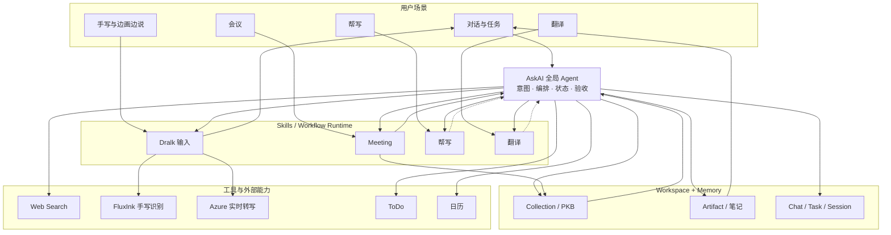
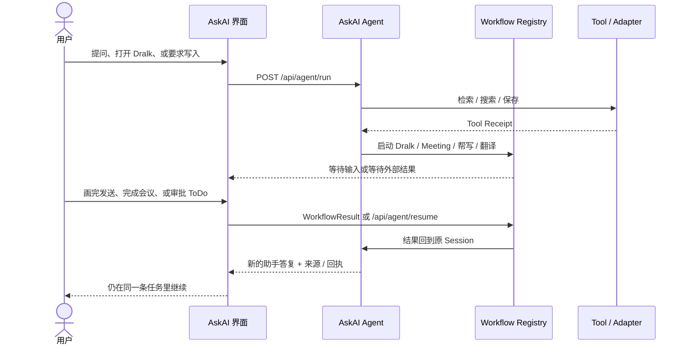
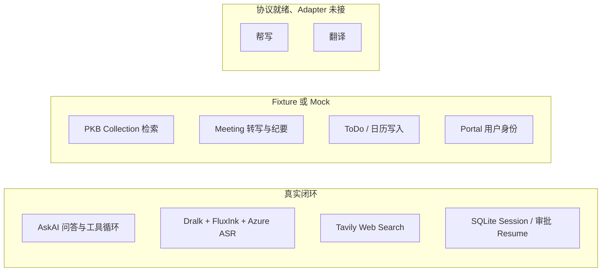

# Agent Canvas / AskAI Agent

可嵌入公司 Portal 的 AskAI 全局 Agent PoC。产品定位不是多 Agent 平台，也还不是平板端侧正式 Runtime：当前仓库证明的是一条 **请求驱动的单 Agent 闭环**——同一个 Chat/Task 里完成问答、工具调用、工作流编排、审批恢复和可验证回执。

预发 Demo：https://dralk-demo.tcljd.com  
当前实现分支：`feature/askai-agent-runtime`

## 现在能做什么

用户在平板竖屏壳（最大宽度 834px）里和 **AskAI** 对话。AskAI 是唯一 Agent：理解意图、调用工具、启动场景工作流、持有任务状态。Dralk / 会议 / 帮写 / 翻译是 AskAI 编排的 Workflow，不是独立 Agent。

| 用户动作 | 实际发生的事 | 当前真实程度 |
| --- | --- | --- |
| 普通提问、总结、结构化答复 | 走 `POST /api/agent/run`，Session 多轮续聊，答案以可编辑文档卡片展示 | 真实模型闭环 |
| 说「打开手写画布」或需要手写输入 | 启动 Dralk Workflow，对话流内嵌 FluxInk 手写 widget；停笔识别后回填输入框，可附带语音说明再发送 | 真实端到端 |
| 问实时新闻 / 天气 / 明确要求联网 | 调用 Tavily Web Search，引用只出现在底部「来源」 | 真实搜索；未配密钥则失败，不回退 Mock |
| 问种子知识库里的会议 / 笔记 | `search_personal_knowledge` 检索 SQLite seed Collection | Fixture 知识，不是真灵感空间 |
| 说「开始会议 / 帮我写 / 翻译这段」 | Agent 通过工具启动对应 Workflow | 会议状态机真、内容 Fixture；帮写/翻译仅登记协议 |
| 要求写入待办 / 日历 | 工具中断 → 用户审批 → `POST /api/agent/resume` → Mock 回执 | 审批闭环真，外部系统假 |

工作流不再提供 Composer 快捷按钮，只由 AskAI 根据用户意图启动。

## 业务架构

AskAI 是全局控制面。灵感空间 / 知识库是 Workspace + Memory，不是并列产品。场景能力是 Skill / Workflow，由 AskAI 调用并写回同一条任务。



虚线表示协议已登记、真实业务 Adapter 尚未接入：帮写和翻译目前只会持久化请求并停在等待外部结果。

### 同一条任务如何闭环

用户看到的始终是一个 Chat/Task。工作流和工具不得另开一套对话，也不得用模型口头声明代替回执。



### 能力边界（真实 / Fixture / 未接入）



PKB 不是 Workflow。未来接真实灵感空间时，替换 `search_personal_knowledge` 的 Service Adapter 即可，不必改 Agent 或 Workflow 协议。

规划中的平板目标架构是：端侧 Runtime 持有任务状态并编排 Workspace / Memory / Skills，云端按需提供模型推理和远程工具。**本仓库对应 Web/Portal PoC，不声称已经实现端侧 Harness。**

## 技术栈

- Next.js 16 + React 19 + TypeScript
- OpenAI Agents JS `@openai/agents@0.13.2`（`openai-agents-js/` 仅作参考 checkout）
- Turing OpenAI-compatible 代理，默认模型 `turing/gpt-5.5`
- SQLite（`node:sqlite`，默认 `./data/agent-canvas.sqlite`）
- FluxInk MCP App widget + 服务端 MCP Streamable HTTP
- Azure Speech SDK 浏览器实时 ASR
- Tavily Web Search

## 目录结构

```text
src/app/page.tsx                         平板竖屏入口
src/app/api/agent/run/route.ts           AskAI 主运行入口
src/app/api/agent/resume/route.ts        审批后从 RunState 续跑
src/app/api/agent/route.ts               旧入口，固定返回 410
src/app/api/workflows/                   Workflow Registry 与兼容 API
src/app/api/conversations/               Chat/Task 读写
src/app/api/projects/                    Collection / Artifact
src/app/api/mcp/                         FluxInk Host / UI resource / 探测
src/app/api/hwr/recognize/route.ts       生产域手写识别代理
src/app/api/asr/realtime/session/        Azure STS token
src/components/CanvasAgentApp.tsx        应用壳：对话、导航、画布、语音
src/components/canvas/FluxInkWidgetHost.tsx
src/components/canvas/HandwritingCanvas.tsx   原生画布保留件，当前 UI 不走这条路径
src/lib/agent/                           Agent、Runner、工具、审批、策略
src/lib/tools/                           云端 Tool Gateway / Connector Registry
src/lib/workflows/                       Dralk / Meeting / Registry
src/lib/mcp/                             MCP 传输与 widget 代理
src/lib/db/                              SQLite schema 与仓库
src/lib/services/                        Mock / 真实 Service Adapter
src/types/                               前后端共享协议
docs/ASKAI_GLOBAL_AGENT_PRD.md
docs/ASKAI_AGENT_UPGRADE_PLAN.md
docs/P0_AGENTIC_CLOSED_LOOP.md
docs/P05_WORKFLOW_REGISTRY.md
docs/DEPLOYMENT.md
```

浏览器只访问同源 Next.js API。密钥、MCP、搜索和模型调用都留在服务端。

## 请求链路

```text
CanvasAgentApp
  → POST /api/agent/run（浏览器 Accept: text/event-stream）
      → Tool Gateway 调 Connector（搜索 / PKB / 工作流 / …）
      → SSE：run.started → tool.started/completed
             → answer.delta / block.delta（正文与 markdown 逐字流式）
             → answer.message + 完整 block/chart（权威值，覆盖流式累积）→ done
      → 表格 / mermaid / latex / 图表只在收到完整对象后渲染，不做半截渲染
  → eval / 脚本不带 SSE Accept 时仍返回一整包 JSON

旧的 `POST /api/agent` 一次性意图路由已经删除。客户端必须带 `conversationId` 走 Session。

Dralk 画布
  → /api/mcp/ui-resource + /api/mcp/host
  → FluxInk widget 识别
  → /api/hwr/recognize（生产域 CORS 代理）
  → 结构化结果回填 Composer，用户确认后再次 /api/agent/run
```

## 环境变量

复制 `.env.example` 为 `.env.local`：

```bash
TURING_API_BASE=https://live-turing.cn.llm.tcljd.com/api/v1
TURING_API_KEY=
TURING_MODEL=turing/gpt-5.5
TAVILY_API_KEY=
WEB_SEARCH_TIMEOUT_MS=15000
WEB_SEARCH_MAX_RESULTS=5
AZURE_STT_KEY=
AZURE_STT_REGION=eastasia
ASR_LANGUAGE_CODE=zh
MCP_SERVER_URL=https://mcp.fluxink.ai/servers/d706699b03524ba6aa84423954c43f3f/mcp
MCP_SERVER_NAME=FluxInk TCL MCP
MCP_AUTH_TOKEN=
MCP_TIMEOUT_MS=120000
PORTAL_FRAME_ANCESTOR_ORIGIN=https://ai.eaglelab.tcl.com https://ai.tcl.com
```

- `TURING_API_KEY` 未配置时，AskAI 不能完成真实问答。
- `TAVILY_API_KEY` 未配置时，Web Search 明确失败，不会返回 Mock 搜索结果。
- 云端实时 ASR 使用 Azure Speech Services；服务端只签发短时 STS token，麦克风识别在浏览器完成。
- 可选：`SQLITE_PATH`、Agent 预算变量（`AGENT_MAX_TURNS` 等）、Portal `X-Portal-User-Id` / `X-Portal-Tenant-Id`。完整列表见 `.env.example`。

## 主要 API

Agent 与会话：

- `POST /api/agent/run`：主入口。浏览器走 HTTP SSE（`Accept: text/event-stream`），正文与 markdown 逐字流式；eval 仍可拿 JSON。
- `POST /api/agent/resume`：审批后续跑，同样支持 SSE / JSON。
- `GET /api/tools/registry`：云端 Tool Gateway 已注册 Connector 列表。
- `POST /api/agent`：已退役，返回 410。
- `GET/POST /api/conversations`、`GET/PATCH /api/conversations/[id]`

工作流：

- `GET /api/workflows/registry`
- `POST /api/workflows/start/:workflowType`
- `POST /api/workflows/result/:workflowId`
- 兼容：`POST /api/workflows/dralk/start`、`/event`；`POST /api/workflows/meeting/start`、`/finish`

知识与产物：

- `GET/POST /api/projects`、`GET /api/projects/[id]`
- `GET /api/projects/[id]/artifacts`、`GET /api/artifacts/[id]`

输入与探测：

- `POST /api/asr/realtime/session`
- `POST /api/mcp/host`、`GET /api/mcp/ui-resource`、`POST /api/hwr/recognize`
- `GET /api/mcp/inspect`、`GET /api/health`
- `POST /api/admin/reset-mock`：重置 seed Collection / 会议 Fixture

## 交互约定

- 画布嵌在触发它的对话位置，而不是独立工作区；默认 inline，可在 widget 内全屏。
- 手写识别结果回填底部 Composer，不写成助手消息。用户可补充指令后再发送。
- 语音转写是附件，不是输入框正文。AskAI 输入框 Enter 发送，Shift+Enter 换行。
- 助手一轮答复是一张文档卡片：导语 + blocks + 图表叠在同一卡片内；网页/PKB 链接只在底部「来源」。
- 编辑答复只能「另存为新笔记」，不会改写 Session 里那条原答复。
- 左侧导航是 Collection / 任务。顶栏「新任务」创建未归属对话；Collection 行内 `+` 在该 Collection 下建任务。
- 种子 Collection 为 Business / Technology / Study / Life / Art，供检索演示；重置：`npm run reset:mock`。

## FluxInk 边界

- 当前手写 UI 来自 FluxInk MCP App widget（`ui://fluxink/fluxink-hwr-canvas.html`），由本项目 Host 嵌入。
- 结构化识别走 FluxInk；生产域名必须经过同源 `/api/hwr/recognize`，否则会碰到 CORS。
- 与 Claude 里观感的差异来自宿主能力、浏览器环境和产品层后处理，不代表识别引擎不同。
- 若画布能打开但工具/资源列表为空，优先检查远端 `MCP_SERVER_URL` 是否仍有效，而不是本地 Host 解析。

## Portal iframe 嵌入

```html
<iframe
  src="https://dralk-demo.tcljd.com"
  title="AskAI Agent"
  style="width: 100%; height: 720px; border: 0"
></iframe>
```

`PORTAL_FRAME_ANCESTOR_ORIGIN` 控制 CSP `frame-ancestors`。Docker 构建阶段未注入时，预发默认允许 `https://ai.eaglelab.tcl.com` 和 `https://ai.tcl.com`。Next.js `headers()` 在镜像构建时求值，只改运行时 `.env` 不会更新 CSP。

## 安全边界

- 模型、搜索、MCP、ASR 密钥只放服务端环境变量。
- 浏览器不直连 MCP server。
- 写操作走 Tool Policy：ToDo / 日历需要审批；Artifact / ToDo / 日历写入带幂等键。
- 审计事件会脱敏后写入 `audit_events`。
- Portal SSO 若要透传，必须由网关设置 `X-Portal-User-Id` / `X-Portal-Tenant-Id`；当前只是占位，不是正式身份体系。

## 本地开发

```bash
npm install
npm run dev
```

常用检查（按需手动执行，本仓库约定不自动编译/构建）：

```bash
npm run typecheck
npm run reset:mock
npm run eval:p05:workflow
npm run eval:p0:live
```

`eval:p0:live` 和 `eval:p05:workflow` 会打真实模型，需要有效的 `.env.local`。

## 预发 / Demo 部署

预发：**https://dralk-demo.tcljd.com**  
版本管理：私有 GitHub `https://github.com/Kevincyq/agent-canvas`（`origin`）。不再向公司 GitLab 提交。

预发部署不依赖 Git 远程。公司网络不允许 GitLab CI 访问预发机，发布始终用本地脚本：

```bash
cp deploy/deploy.env.example deploy/deploy.env   # 首次
npm run deploy:staging
```

流程：`rsync` 当前工作区 → 上传 `.env.local` 为服务器 `.env` → 远端 `docker build` + `docker compose up` → Nginx HTTPS。预发发布不依赖 GitHub push。详情见 [docs/DEPLOYMENT.md](docs/DEPLOYMENT.md)。

```bash
curl -s https://dralk-demo.tcljd.com/api/health
```
