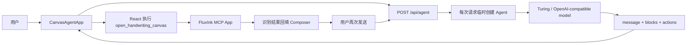
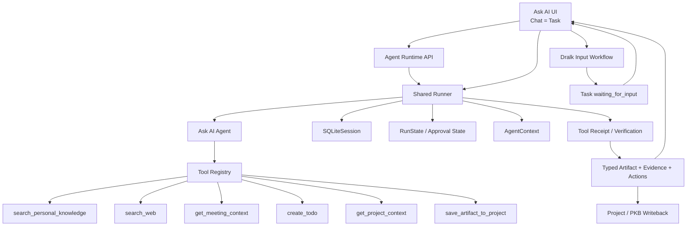
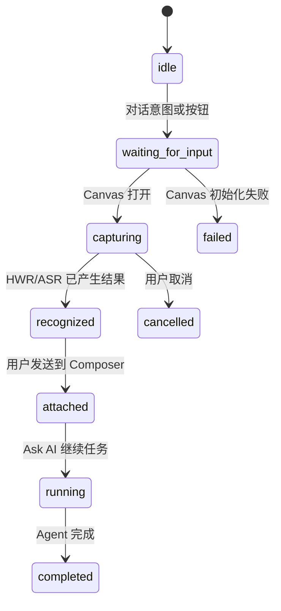

# Agent Canvas - Ask AI 完整 Agent 升级方案

## 0. 文档状态

- 状态：方案已确认，可交给独立编码任务执行
- 适用项目：`/Users/kc/Documents/Agent_Canvas`
- 当前分支：`feature/voice-recording-asr`
- 目标：在保留现有 Dralk 手写、语音和 Typed Blocks 能力的基础上，将 Ask AI 从结构化聊天 PoC 升级为具有工具调用、持久会话、审批恢复、结果验证和 Project/PKB 上下文的单一全局 Agent
- 非目标：本方案不要求建设多 Agent 系统，不把 Dralk 建成 Agent，不要求接入真实 Calendar/ToDo/Meeting 后端

## 1. 已确认的产品与技术决策

### 1.1 P0 验收场景

采用以下端到端场景验证完整 Agent 闭环：

```text
Dralk 手写/语音输入
-> Ask AI 判断是否需要 Project/PKB 或 Web 信息
-> 调用检索工具
-> 生成 Typed Artifact
-> 用户确认写入动作
-> 保存到 Project
-> 返回可验证的工具回执
-> 刷新页面后继续同一个 Chat/Task
```

### 1.2 单 Agent 架构

- 系统中只有一个 `Ask AI Agent`。
- 不创建 `Dralk Agent`。
- Dralk 是用户可见的多模态输入 Workflow。
- Dralk 有两个并存入口：
  - 用户在 Ask AI 对话中表达手写、画图、边画边说等意图，由 Ask AI 调起。
  - 用户点击 Composer 上方的 Dralk 按钮主动调起。
- 两个入口进入同一个 Dralk Workflow 和同一个 Chat/Task，不产生第二套对话或第二个 Agent。

### 1.3 持久化

- PoC 使用 SQLite。
- 基于 OpenAI Agents JS `Session` 接口实现自定义 `SQLiteSession`。
- Session 负责 Agent 对话输入项和输出项的持久化。
- 应用数据库另外保存 ConversationTask、Project、Artifact、Approval、RunState 和 ToolRun 等产品对象。

### 1.4 Mock 策略

- 能稳定 Mock 的业务数据优先使用 Mock。
- 会议、日历和 Project 示例数据使用固定 Fixture 或 SQLite Seed。
- ToDo 写入不接真实系统 API；审批通过后返回结构化“已写入”回执即可。
- Mock 必须通过与未来真实服务相同的 Adapter 接口提供，后续替换实现时不修改 Agent Tool Schema。

### 1.5 模型提供方

- 先验证 Turing Proxy 是否完整支持 function calling、tool result loop、structured output 和 streaming。
- 如果 Turing Proxy 的 function calling/tool call 机制不完整，Agent Runtime 切换到原生 OpenAI Responses API。
- 模型提供方差异收敛在 Provider 配置层，不允许扩散到 Workflow、Tool Schema、Session 和前端协议。

### 1.6 代码基线

- 当前未提交代码由项目负责人自行 Git 提交和整理。
- 正式编码任务必须基于整理后的明确 Commit 开始。
- 本方案不修改当前运行时代码。

## 2. 当前代码架构结论

### 2.1 当前请求链路



### 2.2 当前能力

- Next.js + React + TypeScript。
- `@openai/agents` 已安装。
- Ask AI 云端模型问答。
- FluxInk MCP App Host 与手写识别。
- Azure 实时 ASR。
- Dralk Canvas 内联、全屏、收起和恢复。
- Markdown、Table JSON、Mermaid、LaTeX、Graph JSON、SVG/Image Typed Blocks。
- Typed Blocks 编辑、复制、下载和另存文档。
- MCP Host tool/resource allowlist。

### 2.3 与完整 Agent 的差距

- Agent 没有注册 SDK `tools`。
- Agent 没有使用 `mcpServers`。
- 当前 MCP 只服务 FluxInk Widget，不进入 Ask AI 的 Agent loop。
- 工具结果不会在同一次 run 中返回模型并继续推理。
- 前端手工传最近 8 条消息，不存在持久 Session。
- 页面刷新后聊天、画布状态和文档产物丢失。
- 没有 ConversationTask、Project、Approval 或 RunState 存储。
- 没有 `needsApproval`、Guardrail、工具审计或结果验证。
- `setTracingDisabled(true)` 关闭 SDK Tracing。
- 当前 `message + actions` 是应用级 JSON 指令，不等于 SDK Tool Call。

### 2.4 SDK 版本风险

- 根项目锁文件当前安装 `@openai/agents 0.13.2`。
- 内嵌 `openai-agents-js/` 参考仓库的 package version 是 `0.11.8`。
- 根项目 `package.json` 多个依赖使用 `latest`，构建不可完全复现。

实施时必须：

1. 以根项目实际安装版本和官方文档为准。
2. 固定 `@openai/agents` 及关键依赖版本。
3. 将内嵌 SDK 仓库标记为 reference-only，或升级到与安装版本一致。
4. 不从 0.11.8 示例复制未在 0.13.2 类型中验证的 API。

## 3. 目标产品模型

### 3.1 Chat 与 Task

用户可见层不并列设置 Chats 和 Tasks。

```text
一个 Chat = 一个用户可见 Task 容器
```

任务状态附着在 Chat 上：

```text
ready
running
waiting_for_input
waiting_for_approval
completed
partially_completed
failed
cancelled
```

普通问答不必突出任务状态；只有多步骤执行、Dralk 输入、审批、后台等待、失败和恢复时显示状态。

### 3.2 Project

Project 是长期目标的共享上下文容器：

```text
Project
├── Sources
├── Chats / Tasks
├── Instructions
├── Artifacts
└── Project Memory
```

- 通用 Chat 可以没有 `projectId`。
- Project Chat 默认使用当前 Project Sources 和 Instructions。
- 不是所有聊天内容都自动成为 Project Knowledge。
- Artifact 和用户确认保存的结果才进入 Project/PKB。

### 3.3 Dralk Workflow

Dralk 只负责多模态输入采集与上下文组织：

- Canvas。
- 手写结构化识别。
- 语音 ASR。
- 笔迹、语音和时间绑定。
- Composer handoff。

Dralk 不负责：

- 维护独立 Agent Session。
- 决定最终任务目标。
- 自主调用 Project、PKB、Calendar 或 ToDo。
- 保存长期记忆。
- 生成独立 Chat 历史。

## 4. 目标技术架构



### 4.1 Agent Runtime 责任

- 解析用户目标。
- 选择 Context 和 Tools。
- 执行 SDK tool loop。
- 保存 Session。
- 管理 RunState 与审批。
- 记录 ToolRun。
- 验证工具回执。
- 生成 Typed Blocks、Evidence 和 Artifact。
- 更新 ConversationTask 状态。

### 4.2 前端责任

- 展示 Chat、消息、Typed Blocks 和来源。
- 展示 Agent 进度和 Tool 状态。
- 处理 Dralk Workflow。
- 展示审批卡并收集用户决策。
- 恢复 waiting 状态。
- 不直接宣称系统写入成功。
- 只有收到结构化 Tool Receipt 后显示完成反馈。

## 5. Agent Runtime 设计

### 5.1 Ask AI Agent

只创建一个服务端 Ask AI Agent 实例：

```text
Ask AI Agent
- instructions
- outputType
- tools
- inputGuardrails
- outputGuardrails
- model/provider
```

不创建 Meeting Agent、Dralk Agent、Writing Agent 或 Reading Agent。场景能力通过 Workflow、Tool 和 Context Adapter 实现。

### 5.2 Shared Runner

- 服务启动后创建 Runner，并在请求间复用。
- Runner 负责 Agent loop、Tool Calls、Guardrails、Tracing 和 Session。
- 每次 run 传入当前 `AgentContext`、`SQLiteSession` 和配置。
- 仅在模型 Provider 或安全策略完全不同的情况下创建额外 Runner。

### 5.3 AgentContext

建议结构：

```ts
type AgentContext = {
  userId: string;
  tenantId: string;
  conversationId: string;
  projectId?: string;
  currentSurface: "ask_ai" | "note" | "reader" | "meeting" | "canvas";
  selectedSourceIds: string[];
  permissions: PermissionSnapshot;
  services: ServiceAdapters;
  requestId: string;
};
```

规则：

- Context 中的服务对象和私密运行信息不直接发送给模型。
- 需要让模型看到的信息通过 Instructions、Input Item 或 Read Tool 返回。
- 序列化 RunState 前不得把 Credential Value 放入 Context。

### 5.4 Structured Output

- 继续使用当前 Typed Blocks 作为 Agent 最终产物。
- 将 `AgentResponseSchema` 改造成 SDK `outputType` 可接受的 Zod Schema。
- 不再主要依赖“只输出 JSON”的超长 Prompt 和手工 `JSON.parse`。
- 最终结果除 `message` 和 `blocks` 外，增加：

```text
status
evidence[]
artifacts[]
suggestedActions[]
```

- Canvas 打开不再混在最终 Answer Blocks 中，而是 Workflow Event。

## 6. SQLite 数据设计

### 6.1 建议表

#### projects

```text
id
user_id
name
instructions
created_at
updated_at
```

#### conversations

```text
id
user_id
project_id nullable
title
status
current_step
session_id
origin_surface
created_at
updated_at
```

#### session_items

```text
id
session_id
sequence_no
item_json
created_at
```

`item_json` 存放 SDK `AgentInputItem`，按 `session_id + sequence_no` 保序。

#### run_states

```text
id
conversation_id
state_json
reason
status
created_at
resolved_at nullable
```

用于保存 approval interruption 和可恢复的 SDK `RunState`。

#### approvals

```text
id
conversation_id
run_state_id
call_id
tool_name
arguments_json
risk_level
decision nullable
decision_message nullable
created_at
decided_at nullable
```

#### tool_runs

```text
id
conversation_id
request_id
tool_name
arguments_json
result_json
status
started_at
completed_at nullable
```

#### artifacts

```text
id
conversation_id
project_id nullable
title
artifact_type
blocks_json
evidence_json
created_at
updated_at
```

#### workflow_states

```text
id
conversation_id
workflow_type
status
payload_json
created_at
updated_at
```

Dralk 使用该表保存 `waiting_for_input`、Canvas Session ID、识别结果引用和语音附件引用。

### 6.2 SQLiteSession

自定义 Session 实现 OpenAI Agents JS 接口：

```text
getSessionId()
getItems(limit?)
addItems(items)
popItem()
clearSession()
```

要求：

- 使用事务保证 `sequence_no` 连续。
- `getItems(limit)` 返回时间正序的最近 N 条。
- `addItems` 原子追加一个 run 的输入和输出。
- Session 仅负责对话历史，不承担 Project Memory 或 PKB。
- 测试覆盖并发追加、清空、回退和重新加载。

## 7. Tool Registry 与 Mock Adapter

### 7.1 Adapter 原则

```text
Agent Tool Schema
-> Service Adapter Interface
-> Mock Adapter / Real Adapter
```

模型只看到稳定 Tool Schema，不知道底层是 Mock 还是真实服务。

### 7.2 P0 Tools

| Tool | 类型 | P0 实现 | 审批 | 回执要求 |
|---|---|---|---|---|
| `get_current_context` | Read | 当前 Surface/Project/选区 | 否 | 返回结构化 Context |
| `get_project_context` | Read | SQLite Seed | 否 | Project、Sources、Instructions |
| `search_personal_knowledge` | Read | SQLite/JSON Fixture | 否 | results + sourceId + excerpt |
| `search_web` | Read | Turing/OpenAI 能力或 Mock Adapter | 否 | results + url + title + snippet |
| `get_meeting_context` | Read | 固定会议 Fixture | 否 | event、participants、agenda、history |
| `save_artifact_to_project` | Write L1 | 实际写入 SQLite artifacts | 可先执行后提示 | artifactId + projectId |
| `create_todo` | Write L2 | Mock Adapter | 是 | mockTodoId + title + dueAt + written=true |

### 7.3 Mock 数据建议

准备一个稳定项目：

```text
Project：新品发布筹备
```

包含：

- 两份历史会议纪要。
- 一份产品方案。
- 一份客户反馈摘要。
- 一场下午产品评审会。
- 3 个候选行动项。

Mock 必须稳定且可重复，便于做 Agent Eval。不要每次随机生成不同 ID 和内容；测试环境可使用固定 Fixture ID。

### 7.4 Tool Receipt

所有工具统一返回：

```ts
type ToolReceipt<T> = {
  ok: boolean;
  tool: string;
  executionId: string;
  data?: T;
  error?: {
    code: string;
    message: string;
    retryable: boolean;
  };
  verifiedAt: string;
};
```

`create_todo` Mock 示例：

```json
{
  "ok": true,
  "tool": "create_todo",
  "executionId": "toolrun_todo_001",
  "data": {
    "todoId": "mock_todo_001",
    "title": "提交产品评审修改稿",
    "written": true,
    "provider": "mock"
  },
  "verifiedAt": "2026-07-15T10:00:00Z"
}
```

前端可显示“已写入待办”，同时在详情中标注 PoC Mock，不允许模型自行生成写入成功文案。

## 8. Dralk Workflow 设计

### 8.1 双入口归一

#### 对话意图入口

```text
用户：我想边画边说梳理方案
-> Ask AI 识别 Dralk 输入需求
-> 返回 workflow_request: dralk_input
```

#### 主动按钮入口

```text
用户点击 Composer 上方 Dralk
-> 客户端创建 workflow_request: dralk_input
```

两种入口统一调用：

```text
startDralkWorkflow({
  conversationId,
  origin: "agent_intent" | "user_button",
  prompt?,
  forceNew?
})
```

### 8.2 状态机



### 8.3 Query Payload

Dralk 完成后向同一个 Chat/Task 添加：

```text
recognitionType
structuredContent
displaySummary
strokesRef
voiceTranscriptRef
startMs / endMs
canvasSessionId
confidence
sourceMetadata
```

- Composer 可以只显示简短摘要或附件卡。
- Agent 请求携带完整结构化内容。
- Graph、Formula、Chemical Structure 不得统一压平成一段展示字符串。

## 9. 审批、RunState 与恢复

### 9.1 风险等级

| 等级 | 示例 | 交互 |
|---|---|---|
| L0 | 检索、读取 Project Context | 直接执行 |
| L1 | 保存 Artifact 到当前 Project | 可执行后提示并提供删除/撤销 |
| L2 | 创建 ToDo、Calendar Event | 执行前确认 |
| L3 | 删除、覆盖、发送给外部用户 | P0 不实现 |

### 9.2 审批流程

```text
Agent 调用 needsApproval Tool
-> SDK 返回 interruptions
-> 保存 RunState
-> ConversationTask = waiting_for_approval
-> 前端显示审批卡
-> 用户允许/拒绝
-> 读取并更新 RunState
-> Runner 从原状态恢复
-> Tool 执行或 Agent 调整计划
-> 保存 Tool Receipt
```

### 9.3 恢复要求

- 页面刷新后仍显示待审批内容。
- 服务重启后 RunState 可从 SQLite 读取。
- 审批决策必须按 `callId` 绑定。
- 已处理审批不能重复执行。
- Tool 必须具备幂等键或执行去重策略。
- 拒绝后模型收到明确 rejection message，并决定替代方案。

## 10. Provider 兼容性门槛

### 10.1 Turing Proxy Spike

正式改造前执行以下测试：

| 能力 | 验收 |
|---|---|
| Function calling | 模型返回符合 Schema 的 tool call |
| Tool result loop | Tool 结果返回后模型继续并生成 final output |
| 多 Tool | 能在一项任务中顺序或并行调用多个工具 |
| Structured output | Typed Output Schema 稳定通过 |
| Streaming | text/tool events 可区分且顺序稳定 |
| Tool call identity | call ID 在请求、结果和恢复中一致 |
| Error propagation | Tool error 能回到模型并触发调整 |
| Context length | Session 历史不会因代理限制异常截断 |

### 10.2 Provider 切换规则

以下任一关键项失败且无法通过小范围兼容修复时，Agent Core 切换原生 OpenAI Responses API：

- Function calling 不稳定。
- Tool result 无法进入后续模型回合。
- call ID 不可关联。
- Structured output 无法保证 Schema。
- SDK Runner 与代理协议不兼容。

Provider Adapter 暴露统一配置：

```text
model
apiMode
baseUrl
apiKeyEnvName
supportsTools
supportsStreaming
supportsStructuredOutput
```

不要在业务工具和前端使用 `if (isTuring)` 分支。

## 11. API 协议建议

### 11.1 Agent Run

```text
POST /api/agent/run
```

输入：

```text
conversationId?
projectId?
message
attachments
dralkContext?
currentSurface
```

输出：

```text
conversationId
status
message/items
blocks
evidence
workflowRequest?
approvals?
artifacts
```

### 11.2 Resume Approval

```text
POST /api/agent/resume
```

输入：

```text
conversationId
runStateId
decisions[{callId, decision, message?}]
```

### 11.3 Conversations

```text
GET /api/conversations
GET /api/conversations/:id
POST /api/conversations
PATCH /api/conversations/:id
```

### 11.4 Projects

```text
GET /api/projects
GET /api/projects/:id
GET /api/projects/:id/artifacts
```

P0 可使用 Seed Project，不要求完整 Project 管理 UI。

## 12. 前端改造范围

### 12.1 ChatPanel

- Composer 上方增加 Dralk 主动入口。
- 保留自然语言意图入口。
- 展示 Agent 状态：运行、等待输入、等待确认、部分完成、失败。
- 展示 Tool timeline，但不展示模型内部思维链。
- 展示 Evidence / Sources。
- 展示 Approval Card。
- 展示 Tool Receipt 和 Artifact Deep Link。

### 12.2 CanvasAgentApp

当前组件同时承担过多责任，编码任务应逐步拆分：

```text
useConversationTask
useAgentRun
useDralkWorkflow
useApprovalResume
useArtifactEditor
```

- 服务端成为消息和任务状态事实源。
- React State 只保留当前 UI 临时状态。
- 保留现有 Canvas 收起后不卸载、重新展开和 Composer 聚焦行为。

### 12.3 左侧导航

P0 可以只提供简化版本：

```text
New Chat
Projects
- 新品发布筹备
Recent
- 当前 Chat
```

- 不并列显示 Chats 和 Tasks。
- 每个 Chat 可显示状态标签。
- Activity 视图不属于 P0；需要跨 Project 后台任务时再增加。

## 13. 建议代码结构

```text
src/
├── lib/
│   ├── agent/
│   │   ├── ask-ai-agent.ts
│   │   ├── runner.ts
│   │   ├── context.ts
│   │   ├── result.ts
│   │   ├── guardrails.ts
│   │   ├── provider.ts
│   │   └── tools/
│   │       ├── get-current-context.ts
│   │       ├── get-project-context.ts
│   │       ├── search-pkb.ts
│   │       ├── search-web.ts
│   │       ├── get-meeting-context.ts
│   │       ├── save-artifact.ts
│   │       └── create-todo.ts
│   ├── db/
│   │   ├── client.ts
│   │   ├── migrations/
│   │   └── repositories/
│   ├── session/
│   │   └── sqlite-session.ts
│   ├── task/
│   │   ├── task-store.ts
│   │   └── task-state.ts
│   ├── workflows/
│   │   └── dralk.ts
│   └── services/
│       ├── adapters.ts
│       ├── mock/
│       └── real/
├── app/api/
│   ├── agent/run/route.ts
│   ├── agent/resume/route.ts
│   ├── conversations/route.ts
│   └── projects/route.ts
└── types/
    ├── agent-runtime.ts
    ├── task.ts
    ├── tool-receipt.ts
    └── workflow.ts
```

无需一次性物理移动全部现有文件。编码任务应先建立新 Agent Core，再逐步迁移旧 `agent.ts`、`intent.ts` 和 `/api/agent`。

## 14. 实施里程碑

### M0 - 基线与 Provider Spike

- 固定依赖版本。
- 明确内嵌 SDK reference 边界。
- 完成 Turing Tool Calling 兼容性报告。
- 确定使用 Turing 或 OpenAI Responses。

退出条件：一个最小 Agent 能调用 `echo_tool`，读取结果并继续生成 final output。

### M1 - SQLite + Conversation Session

- 建表和 migration。
- 实现 `SQLiteSession`。
- ConversationTask API。
- 刷新恢复历史。

退出条件：服务重启后同一 `conversationId` 可以继续问答。

### M2 - Ask AI Agent Core

- Shared Runner。
- AgentContext。
- Zod outputType。
- Provider Adapter。
- 基础 Guardrails 和 Tool Receipt。

退出条件：不再手工拼最近 8 条消息；Agent 通过 Session 和 Runner 完成多轮。

### M3 - Tool Registry + Mock Services

- Project、PKB、Web、Meeting、Artifact、ToDo Tools。
- Seed 数据。
- Tool logging。
- Tool result loop。

退出条件：Agent 至少完成两个 Read Tool 和一个 Write Tool 的组合任务。

### M4 - Dralk Workflow

- 双入口归一。
- waiting_for_input。
- 结构化 Dralk Context。
- 刷新恢复 Canvas Workflow。

退出条件：Dralk 前后保持同一 ConversationTask。

### M5 - Approval + RunState Resume

- `needsApproval`。
- RunState SQLite 持久化。
- Approval Card。
- approve/reject/resume。
- 幂等与重复执行保护。

退出条件：刷新或重启后可以批准 Mock ToDo 并恢复原任务。

### M6 - Project UX + Evidence + Artifact

- 简化 Project/Recent 导航。
- Sources/Evidence。
- 保存 Artifact。
- 结果回执。

退出条件：P0 端到端验收场景完整通过。

### M7 - Eval、Tracing 与部署

- Agent Eval Fixtures。
- Tool 成功率和延迟。
- 结构化审计日志。
- 敏感信息脱敏。
- SQLite Docker volume。
- Portal 用户上下文占位。

退出条件：预发环境可重复执行 P0 场景，失败原因可以通过日志定位。

## 15. P0 验收用例

### Case 1 - 对话调起 Dralk

```text
用户：我想边画边说整理新品发布方案
```

- Ask AI 识别 Dralk Workflow。
- Task 进入 `waiting_for_input`。
- Canvas 在当前 Chat 中打开。
- 不创建第二个 Agent 或第二条 Chat。

### Case 2 - 按钮调起 Dralk

- 用户点击 Composer 上方 Dralk。
- 进入与 Case 1 相同的 Workflow。
- `origin=user_button`。

### Case 3 - 多工具检索

- Dralk 输入包含产品发布计划。
- Ask AI 调用 `get_project_context`。
- 调用 `search_personal_knowledge`。
- 必要时调用 `search_web`。
- Tool 结果进入同一次 Agent loop。
- 输出带来源 Typed Artifact。

### Case 4 - Mock Meeting Context

- 用户要求准备下午评审会。
- Agent 调用 `get_meeting_context`。
- 返回固定会议、参与人、历史纪要和议程。
- Agent 生成 Meeting Brief。

### Case 5 - Mock ToDo Approval

- Agent 从结果中提出 3 个行动项。
- 调用 `create_todo` 时暂停。
- UI 显示审批卡。
- 用户确认后恢复 RunState。
- Mock Tool 返回 `written=true`。
- UI 显示已写入反馈。

### Case 6 - 拒绝审批

- 用户拒绝创建 ToDo。
- Agent 不执行 Mock Tool。
- Agent 保留行动项文本，并说明未写入系统。

### Case 7 - 刷新恢复

- 在 `waiting_for_input` 或 `waiting_for_approval` 时刷新页面。
- Chat、Workflow、Approval 和 RunState 恢复。
- 不重复调用已完成工具。

### Case 8 - Provider 降级

- Turing 不支持工具循环时，配置切换 OpenAI Responses。
- 前端协议、Tool Schema、Session 数据和验收用例保持不变。

## 16. 非功能要求

### 安全

- Credential 只存环境变量。
- Context 和 RunState 不持久化 Credential Value。
- Tool allowlist。
- Write Tool 审批。
- SQLite 文件不暴露给浏览器。
- Portal user/tenant 信息由服务端验证。

### 可恢复性

- Tool 调用设置 timeout。
- Read Tool 可有界重试。
- Write Tool 使用幂等键。
- RunState 可序列化。
- UI 可恢复 waiting 状态。

### 可观测性

- 每个请求生成 `requestId`。
- ToolRun 与 `conversationId` 关联。
- 记录 Provider、Model、Tool、耗时、结果状态和错误码。
- 不记录 Credential、完整语音或未经授权的敏感内容。

### 性能

- Session 支持 limit 和后续 compaction。
- 不在每次请求连接全部 MCP Server。
- Seed/Mock Tool 延迟可配置，用于验证 loading 状态。
- Streaming 可在 Provider Spike 通过后启用。

## 17. 实施边界与避免事项

P0 不做：

- 多 Agent、Handoff 或 Agent-as-Tool。
- 独立 Dralk Agent。
- 真实 Calendar/ToDo/Meeting 集成。
- 自动写入全部聊天到长期记忆。
- 全量 Tablet 系统工具。
- 完整 Project 管理后台。
- 跨设备同步。
- 主动 Agent 和复杂自动化。
- 一次性重写 FluxInk Widget、Azure ASR 和 Typed Blocks。

禁止把以下行为当成完成：

- 模型输出“已创建待办”，但没有 Tool Receipt。
- 前端执行 action 后不向任务状态写回。
- 继续只传最近 8 条消息冒充 Session。
- 把 Dralk 识别结果压成一段文本丢失结构。
- 把 SDK Session 当成 PKB 长期记忆。
- 用多 Agent 掩盖 Tool 和 Workflow 边界不清。

## 18. 编码任务启动检查清单

编码任务开始前确认：

- [ ] 项目负责人已提交/整理当前工作区改动。
- [ ] 新分支从明确 Commit 创建。
- [ ] 根项目依赖版本已固定。
- [ ] 选择 SQLite library 和 migration 方案。
- [ ] 完成 Turing Provider Spike。
- [ ] 确认 Agent Runtime 使用 Turing 或 OpenAI Responses。
- [ ] 固定 P0 Seed Project 和 Fixture。
- [ ] Tool Schema 已评审。
- [ ] SQLite Schema 已评审。
- [ ] P0 验收用例转成自动化或可重复手工测试。

## 19. 官方 SDK 依据

- OpenAI Agents SDK JS：<https://openai.github.io/openai-agents-js/>
- Tools：<https://openai.github.io/openai-agents-js/guides/tools/>
- Sessions：<https://openai.github.io/openai-agents-js/guides/sessions/>
- Running Agents：<https://openai.github.io/openai-agents-js/guides/running-agents/>
- Human-in-the-loop：<https://openai.github.io/openai-agents-js/guides/human-in-the-loop/>
- Guardrails：<https://openai.github.io/openai-agents-js/guides/guardrails/>
- Results / RunState：<https://openai.github.io/openai-agents-js/guides/results/>

## 20. 最终交付定义

完成本方案后，Agent Canvas 应达到以下状态：

> 用户在一个持久 Chat/Task 中通过文本、手写或语音表达目标；Ask AI 能选择并调用 Project/PKB/Web/Meeting Mock 工具，把工具结果带回 Agent loop，生成可编辑的 Typed Artifact；写入 ToDo 等动作经过用户确认，并以真实或 Mock Tool Receipt 验证；Dralk 作为同一任务的输入 Workflow 可从对话意图或按钮调起；页面刷新或服务重启后任务、审批和会话可恢复。

这构成 PoC 层面的最小完整 Agent 闭环。

