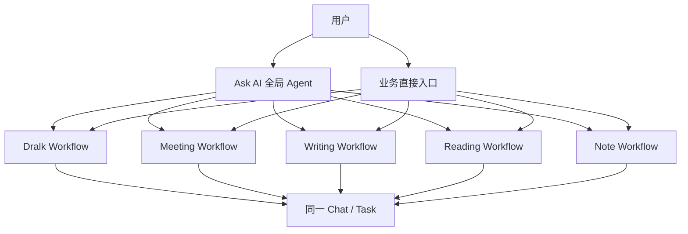

# Ask AI 全局 Agent PRD

## 0. 文档信息

| 项目 | 内容 |
|---|---|
| 产品名称 | Ask AI 全局 Agent |
| 所属产品 | Tablet / Inspiration Space |
| 文档版本 | v0.9 |
| 文档状态 | 产品方案稿，待 PoC 验证后补充 UI/UX |
| 更新日期 | 2026-07-15 |
| 目标读者 | 产品、设计、Agent 工程、客户端、服务端、算法、测试 |
| 关联方案 | `docs/ASKAI_AGENT_UPGRADE_PLAN.md` |
| UI/UX 状态 | 暂不固化视觉方案；PoC 完成后补充截图、页面结构和动效说明 |

### 0.1 本版本重点

本版本优先回答两个问题：

1. 用户在什么场景下使用 Ask AI，全局 Agent 应完成什么任务。
2. 为完成这些任务，产品需要提供哪些功能，以及每项功能的优先级和验收边界。

本版本不以页面稿为中心。除必要的入口、状态和反馈规则外，不规定具体布局、控件尺寸、颜色或动效。

---

## 1. 产品结论

Ask AI 不再只是一个支持个人知识库、通用问答和 Web Search 的聊天入口，而是 Tablet 上唯一的全局 Agent。

它负责：

- 理解用户当前所处场景和真实意图。
- 判断应直接回答、检索知识、启动 workflow，还是调用工具执行行动。
- 在复杂任务中形成计划，并持续推进到可验证的结果。
- 在需要写入、发送、创建等操作前获得用户确认。
- 记住任务上下文、Project 上下文和经用户允许的长期偏好。
- 将 Note、阅读、会议、写作、Dralk 等既有场景连接为连续的 AI 工作流。

系统中只有一个 Ask AI Agent。

Dralk、Meeting、Writing、Reading、Note 等不是独立 Agent，而是由 Ask AI 调度、也可以由用户从原有业务入口主动启动的 workflows。无论从对话意图还是业务按钮进入，均回到同一个 Chat/Task 中继续。

---

## 2. 背景与问题

### 2.1 当前已上线能力

当前 Ask AI 已升级为 Tablet 首页入口，支持：

- 通用问答。
- Inspiration Space / 个人知识库检索问答。
- 指定 Collection 或指定资料范围问答。
- Web Search。
- 对话历史。
- 引用来源。
- 将问答结果保存到 Note。
- 从全局圈选、Note 图片、Inspiration Space 等入口发起问答。

Inspiration Space 当前支持 Note、文件、图片、录音、网页链接等内容的收集、AI 摘要、OCR、转写和分类。

### 2.2 当前产品本质

当前 Ask AI 的核心仍然是“带检索范围的问答系统”：

```text
用户提问
-> 选择知识范围
-> RAG / 通用模型 / Web Search
-> 生成答案
-> 用户复制、分享或保存
```

它可以给出信息，但不能稳定地把用户目标推进为行动结果。

### 2.3 关键差距

| 差距 | 当前表现 | 对用户的影响 |
|---|---|---|
| 意图理解不足 | 依赖用户主动选择问答范围或入口 | 用户必须先理解系统能力和信息架构 |
| 缺少任务规划 | 一次提问对应一次生成 | 复杂任务需要用户反复拆解和追问 |
| 缺少工具闭环 | 模型可以描述“应该怎么做”，但不能可靠执行 | “回答了”不等于“完成了” |
| 缺少审批机制 | 写入类动作没有统一确认边界 | 用户无法判断 AI 是否已经改变系统状态 |
| 缺少执行验证 | 文案可能声称已创建或已保存 | 结果不可核验，信任成本高 |
| 场景割裂 | Note、会议、写作、阅读、Dralk 各自形成孤岛 | 上下文无法连续，用户重复搬运资料 |
| 会话不等于任务状态 | 历史主要用于找回聊天内容 | 无法表达进行中、待确认、失败、已完成 |
| Collection 心智弱 | 系统预置 Business/Learning/Life 等分类难以理解 | 用户更倾向自建文件夹，AI 分类价值未被感知 |
| 缺少记忆分层 | 会话、Project、个人偏好混在上下文里 | 要么每次重复说明，要么产生越权记忆风险 |

---

## 3. 产品目标与非目标

### 3.1 产品目标

#### G1. 从问答升级为任务完成

用户表达目标后，Ask AI 能自主选择信息源、workflow 和工具，并推进到一个可验证的结果。

#### G2. 形成 Tablet 全局统一智能入口

用户不需要理解每项 AI 能力位于哪个应用中。Ask AI 可以在首页、Note、Reader、Meeting、Dralk 等场景理解当前上下文并继续任务。

#### G3. 将 Inspiration Space 升级为统一个人知识库

用户收集到 Inspiration Space 的内容，可以被组织进 Project，参与问答、写作、会议、阅读和行动工作流，并持续沉淀任务产物。

#### G4. 建立可控、可信的行动机制

所有产生外部影响的动作必须具备明确的预览、确认、执行状态和工具回执。

#### G5. 保留业务场景的直接入口

用户仍然可以直接点击 Dralk、Meeting、Writing 等业务入口。全局 Agent 不意味着所有操作必须先进入 Ask AI 对话框。

### 3.2 非目标

本阶段不做：

- 多 Agent 产品架构。
- 独立 Dralk Agent、Meeting Agent 或 Writing Agent。
- 让 Agent 在无授权、无确认的情况下持续自主操作。
- 用聊天历史替代完整的个人长期记忆系统。
- 直接重构 Tablet 的全部传统文件管理系统。
- 在 PoC 阶段接入所有真实业务服务。
- 在 PoC 截图形成前固化最终 UI/UX。

---

## 4. 产品原则

### 4.1 一个 Agent，多种 Workflow，多入口

Ask AI 是唯一负责理解目标、路由、规划和结果整合的 Agent。Workflow 是完成某类场景任务的标准过程，既可由 Agent 调起，也可由用户直接启动。



### 4.2 Chat 就是用户可见的 Task

不在用户侧再创建一套独立“Task 列表”。每个 Chat 是一个可持续推进的任务容器，同时具有状态：

- 进行中。
- 等待用户确认。
- 等待外部结果。
- 已完成。
- 已失败。
- 已取消。

“正在生成会议纪要”“等待确认 3 个待办”“已完成客户回访方案”是 Chat/Task 的状态摘要，不是另一种对象。

### 4.3 Project 是长期工作上下文，不只是文件夹

现有 Collection 逐步升级为 Project。Project 至少包含：

- 资料 Sources。
- 相关 Chats/Tasks。
- Agent 生成的 Artifacts。
- Project Instructions。
- 经确认的 Project Memory。
- 权限和共享边界。

用户可以发起不属于任何 Project 的通用 Chat，也可以在具体 Project 内工作。Project 内创建的 Chat 默认保留在该 Project。

### 4.4 默认分类不再作为一级强制结构

Business、Learning、Arts、Technology、Life 等预置分类不应继续占据用户 Project 列表的主要位置，也不应不可删除地要求用户理解。

建议处理方式：

- 用户自建 Collection 迁移为 Project。
- 预置分类降级为可选 Smart Views / AI Tags。
- Smart Views 用于筛选和推荐，不决定资料的唯一归属。
- RAG 准确率通过 Project scope、显式引用、检索策略和重排提升，而不是依赖固定分类。

该调整解决的是信息架构和用户心智问题，不等同于删除底层分类标签。

### 4.5 回答、产物和行动必须区分

- Answer：供用户阅读的解释或结论。
- Artifact：可编辑、可保存、可继续加工的结构化成果。
- Action：改变系统或外部世界状态的工具执行。

模型生成“已创建待办”不代表 Action 成功。只有工具返回可验证 Tool Receipt 后，产品才可以显示“已写入”。

### 4.6 最小必要确认

Agent 应减少不必要的追问，但不能跳过有真实风险的确认：

- 信息不足但可安全推断：先执行低风险步骤，并显示假设。
- 会改变用户数据或外部状态：执行前确认。
- 高风险、不可逆或涉及他人：逐项确认或禁止自动执行。

---

## 5. 目标用户与核心任务

### 5.1 目标用户

#### U1. 知识工作者

需要跨 Note、文档、网页、会议和手写内容进行研究、总结、写作和跟进。

#### U2. 学习者

需要理解资料、整理知识、生成学习材料、关联不同来源并持续追问。

#### U3. 创意与方案工作者

需要通过手写、画图、语音和文本表达想法，再转换成可编辑文档、图表、计划或演示结构。

#### U4. 高频会议用户

需要从会议资料和录音中形成纪要、决策、待办，并回写到个人任务系统。

### 5.2 Jobs to be Done

| JTBD | 用户目标 |
|---|---|
| 捕捉 | 当灵感或信息出现时，快速收进统一知识库，不中断当前工作 |
| 理解 | 基于个人资料和可信外部信息获得带来源的解释 |
| 组织 | 把零散资料、对话和产物组织到一个持续工作的 Project 中 |
| 创作 | 把手写、语音、阅读摘录和资料转成可编辑成果 |
| 决策 | 汇总证据、比较方案、识别风险并形成建议 |
| 行动 | 将结论转成待办、日程、笔记或其他系统动作 |
| 延续 | 刷新、退出或切换场景后，继续同一个未完成任务 |

---

## 6. 核心对象与术语

| 对象 | 产品定义 | 用户可见 |
|---|---|---|
| Ask AI Agent | 唯一的全局目标理解、路由、规划与执行主体 | 是 |
| Chat/Task | 一次可持续的目标处理过程，聊天内容与任务状态属于同一对象 | 是 |
| Project | 围绕长期主题或目标组织 Sources、Chats、Artifacts、Instructions 和 Memory 的容器 | 是 |
| Source | Note、文件、图片、音频、网页、圈选片段等事实来源 | 是 |
| Workflow | 特定场景下的标准工作流，如 Dralk、Meeting、Writing | 是，以场景能力呈现 |
| Skill | Agent 可调用的一组稳定方法、规则或工作流能力 | 通常不直接暴露技术名称 |
| Tool | 检索、读取、保存、创建待办等可执行能力 | 以执行状态和回执呈现 |
| Artifact | Agent 生成的可编辑成果，如纪要、文章、表格、图表、方案 | 是 |
| Approval | 对写入或外部影响动作的用户确认 | 是 |
| Tool Receipt | 工具执行后的结构化结果证明 | 是，以成功/失败详情呈现 |
| Memory | 会话、Project 或个人层面的可复用信息 | 部分可见、可管理 |

---

## 7. 场景总览

| 场景域 | 典型入口 | Ask AI 的职责 | 主要产物/行动 |
|---|---|---|---|
| 通用问答 | Tablet 首页 Ask AI | 直接回答，必要时澄清 | Answer |
| 个人知识库问答 | Ask AI / Inspiration Space / Project | 选择范围、检索、引用、综合 | 带来源 Answer |
| Web Search | Ask AI | 判断时效性需求、搜索、交叉验证 | 带网页来源 Answer |
| Project 工作 | Project 内 Ask AI | 自动继承上下文、持续任务 | Artifact / Action |
| 全局圈选 | 任意页面圈选后 Ask AI | 接收选区和来源上下文 | 解释、保存、继续任务 |
| Dralk | 对话意图或 Composer 上方按钮 | 启动手写/语音 workflow，理解结构 | 图、表、文档、计划 |
| Meeting | 会议入口或对话意图 | 获取议程/录音/资料，生成纪要和待办 | 纪要、决策、ToDo |
| Note | Note 内入口或对话意图 | 读取当前 Note，续写、整理、变换结构 | 更新或新建 Note |
| Writing | 写作入口或对话意图 | 收集要求、研究、起草、修改 | 可编辑文稿 |
| Reading | Reader 入口或圈选 | 解释、总结、对比、记录 | 摘要、卡片、问题清单 |
| 跨场景延续 | 历史 / Project / 系统恢复 | 恢复任务状态和待确认动作 | 继续执行 |

---

## 8. Use Case 列表

### 8.1 优先级定义

- P0：完整 Agent PoC 和第一阶段产品闭环必须具备。
- P1：PoC 后进入产品化的核心场景。
- P2：规模化和主动智能阶段。

### 8.2 Use Case 总表

| ID | Use Case | 优先级 | 核心能力 |
|---|---|---:|---|
| UC-01 | 通用问答 | P0 | 直接回答、追问、停止生成 |
| UC-02 | 全部个人知识库问答 | P0 | PKB 检索、引用、范围说明 |
| UC-03 | Project 内持续问答与工作 | P0 | Project context、持久任务 |
| UC-04 | Web Search 与时效信息问答 | P0 | 搜索、来源、时效标记 |
| UC-05 | 个人知识库 + Web 混合研究 | P0 | 多源路由、证据合并 |
| UC-06 | 保存 Agent 产物到 Project | P0 | Artifact、写入回执 |
| UC-07 | 从按钮主动启动 Dralk | P0 | Workflow 启动、同一任务恢复 |
| UC-08 | Ask AI 通过意图启动 Dralk | P0 | 意图识别、Workflow 路由 |
| UC-09 | Dralk 手写/语音转结构化成果 | P0 | 多模态上下文、Typed Artifact |
| UC-10 | 创建待办并获得确认 | P0 | Tool、Approval、Receipt |
| UC-11 | 刷新或退出后恢复任务 | P0 | Session、RunState、状态恢复 |
| UC-12 | Agent 失败、取消与重试 | P0 | 可恢复错误、幂等执行 |
| UC-13 | 会议纪要与行动项 | P1 | Meeting Workflow、ToDo |
| UC-14 | Note 整理、续写与写回 | P1 | Note context、版本化写入 |
| UC-15 | 基于 Project 的完整写作流程 | P1 | 研究、提纲、初稿、修改 |
| UC-16 | Reader 阅读理解与知识沉淀 | P1 | 页面上下文、摘录、Project |
| UC-17 | 全局圈选后继续 Ask AI 任务 | P1 | 当前屏幕上下文、来源回溯 |
| UC-18 | 多步骤目标规划与进度呈现 | P1 | Plan、step status、重规划 |
| UC-19 | Project 创建、迁移与管理 | P1 | Collection 升级、scope |
| UC-20 | 用户修正检索范围或 Agent 假设 | P1 | Context control、重新执行 |
| UC-21 | Project 指令与模板复用 | P1 | Project Instructions、Skill |
| UC-22 | 个人偏好记忆与管理 | P2 | Long-term Memory、可见可删 |
| UC-23 | 后台长任务和完成通知 | P2 | Async task、notification |
| UC-24 | Agent 主动建议下一步 | P2 | Event trigger、可关闭建议 |

---

## 9. P0 Use Case 详细定义

### UC-01 通用问答

**用户目标**

用户希望不选择知识库、不创建 Project，直接获得通用解释、建议、计算或内容生成。

**入口**

- Tablet 首页 Ask AI。
- Ask AI 新 Chat。

**前置条件**

- Ask AI 服务可用。
- 用户已完成必要的 AI 授权。

**主流程**

1. 用户输入问题。
2. Ask AI 判断问题不需要个人资料、实时网页或业务工具。
3. Ask AI 直接生成回答。
4. 用户可以继续追问、停止生成、复制或将回答转换为 Artifact。

**异常/分支**

- 问题存在关键歧义：Ask AI 只询问会显著改变结果的必要信息。
- 用户要求最新信息：转入 UC-04。
- 用户提到“我的资料”“这个项目”等上下文：Ask AI 尝试匹配 Project 或请求用户选择范围。

**结果**

- Chat/Task 被创建并保留。
- 回答明确标识是否使用了外部来源。

**验收标准**

- 不需要知识库时，不得为了展示 Agent 能力而无意义调用工具。
- 用户停止生成后，已生成内容保留，任务状态为“已停止”而不是“失败”。
- 用户可以在同一 Chat 中继续追问。

---

### UC-02 全部个人知识库问答

**用户目标**

用户希望从全部 Inspiration Space 中找到、汇总或比较自己的资料。

**示例**

- “我之前记录过哪些关于 Agent memory 的观点？”
- “汇总我最近三次客户会议里提到的共同风险。”

**主流程**

1. 用户提出涉及个人资料的问题。
2. Ask AI 识别为 PKB 检索意图，默认范围为 All Inspiration。
3. 系统检索相关 Sources，并进行重排和相关性判断。
4. Ask AI 基于命中内容回答，并为事实结论关联来源。
5. 若个人知识库证据不足，Ask AI 明确说明，并询问是否使用 Web 或通用知识补充；若用户问题已授权混合检索，可直接进入 UC-05。

**异常/分支**

- 无命中：说明未在个人知识库找到，不伪造来源。
- 命中内容冲突：展示冲突来源及时间，避免强行合并为单一事实。
- Source 尚未完成 OCR/转写/索引：标记不可用状态并允许稍后重试。

**验收标准**

- 每个来自 PKB 的关键事实可回溯到 Source。
- 答案必须显示当前检索范围。
- 用户可以打开 Source 详情或回到原 Note/Reader 页面。
- 不得把模型通用知识伪装成个人资料内容。

---

### UC-03 Project 内持续问答与工作

**用户目标**

用户希望围绕一个长期主题持续积累资料、对话和产物，不必每次重新指定范围。

**示例**

- 在“新品发布筹备”Project 中询问：“根据已有资料，下一步还缺什么？”
- 在“客户回访优化”Project 中继续上周未完成的方案。

**入口**

- 从 Project 内创建 Chat。
- 从 Ask AI 将通用 Chat 移入 Project。
- 从历史恢复已属于 Project 的 Chat。

**主流程**

1. 用户进入 Project 或恢复 Project Chat。
2. Ask AI 自动加载 Project 的 Sources、Instructions、相关 Artifacts 和必要 Memory。
3. 用户提出问题或目标。
4. Agent 优先在当前 Project 范围内检索和执行。
5. 生成的新 Artifact 默认建议保存到当前 Project。
6. Chat/Task 持续保留在该 Project 中。

**异常/分支**

- 当前 Project 资料不足：Ask AI 可建议扩大到 All Inspiration 或 Web，但必须显示范围变化。
- 用户明确要求跨 Project：获得确认后临时增加范围，不自动改变 Chat 的归属。
- 用户从 Project 移除 Source：后续回答不再使用；历史答案保留当时的引用快照。

**验收标准**

- Project 内新 Chat 默认继承 Project scope。
- 用户无需每轮重复指定 Project。
- 范围扩大或缩小时，界面状态和答案来源必须同步更新。
- Chat 移出 Project 后，不再默认读取该 Project 私有上下文。

---

### UC-04 Web Search 与时效信息问答

**用户目标**

用户询问新闻、价格、政策、产品更新、近期事件或明确要求搜索网页。

**主流程**

1. Ask AI 判断信息具有时效性或用户明确要求 Web Search。
2. Agent 发起 Web Search。
3. 对结果做相关性、来源质量和时间判断。
4. 将搜索证据带回 Agent，生成带网页来源的回答。
5. 显示搜索时间和主要来源。

**异常/分支**

- 搜索结果不足：说明限制，不以旧知识冒充最新信息。
- 来源相互冲突：并列呈现差异。
- 网络不可用：保留问题，支持恢复后重试。

**验收标准**

- 时效性问题优先使用 Web Search。
- 关键外部事实可打开原网页。
- 不得把网页结果自动加入个人知识库；保存必须由用户触发或确认。

---

### UC-05 个人知识库 + Web 混合研究

**用户目标**

用户希望结合自己的资料和外部最新信息完成分析、比较或方案。

**示例**

- “结合我们已有的平板 Agent 规划和最新竞品信息，列出差距。”
- “用我的旅行计划和最新天气生成三天行程。”

**主流程**

1. Agent 将目标拆分为个人资料检索和 Web Search 两部分。
2. 两类检索可以并行执行。
3. Agent 区分内部事实、外部事实和自身推理。
4. Agent 生成综合结论，并保留各自来源。
5. 用户可将结果保存为 Artifact。

**验收标准**

- 引用必须区分 Personal Knowledge 和 Web。
- 不同来源发生冲突时不得静默覆盖。
- Agent 的推断必须与来源事实可区分。

---

### UC-06 保存 Agent 产物到 Project

**用户目标**

用户希望把有价值的回答或结构化成果保存下来，成为后续可编辑和可检索的 Project 资产。

**主流程**

1. Agent 生成 Typed Artifact，例如 Markdown、表格、Mermaid、LaTeX、Graph 或媒体内容。
2. 用户检查或编辑 Artifact。
3. 用户选择保存到当前 Project，或选择目标 Project。
4. 系统执行保存工具。
5. 工具返回 Artifact ID、Project ID、时间和状态。
6. 产品显示“已保存”及可打开的回执。

**异常/分支**

- 未选择 Project：可以保存为未归属 Artifact，或要求选择 Project，取决于产品阶段配置。
- 同名：允许自动添加序号或提示覆盖/另存。
- 保存失败：保留本地编辑内容，支持重试。

**验收标准**

- 只有收到工具成功回执后才显示“已保存”。
- 刷新后 Artifact 仍存在。
- 保存后的 Artifact 可被 Project 后续 Chat 检索或引用。

---

### UC-07 从按钮主动启动 Dralk

**用户目标**

用户希望明确进入边画边说，不需要先用自然语言要求 Ask AI 打开画布。

**入口**

- Ask AI Composer 上方 Dralk 按钮。
- 未来可保留 Note 内现有 Dralk 入口。

**主流程**

1. 用户点击 Dralk。
2. 系统在当前 Chat/Task 中创建 Dralk Workflow State。
3. 用户进行手写，可选择同时录音。
4. 识别结果和可用结构被作为附件回到同一 Composer/Task。
5. 用户补充要求并发送。
6. Ask AI 继续检索、生成 Artifact 或执行下一步。

**验收标准**

- 不创建第二个 Agent 或第二个 Chat。
- 关闭、收起或重新打开画布时，当前 Dralk session 保留。
- 语音是可选输入；只手写也能完成发送。
- 结构化识别结果不得被压平为仅供展示的一段文本。

---

### UC-08 Ask AI 通过意图启动 Dralk

**用户目标**

用户用自然语言表达需要画图、手写或边画边说，系统自动进入合适 workflow。

**示例**

- “我想画一下这个系统的架构，你边看边帮我整理。”
- “打开画布，我边画边讲。”

**主流程**

1. Ask AI 识别 Dralk workflow intent。
2. Agent 返回 workflow start 指令，而不是仅回复操作说明。
3. 系统在当前 Chat/Task 中打开 Dralk。
4. 后续流程与 UC-07 共用同一状态机和输入协议。

**验收标准**

- 意图入口与按钮入口必须调用同一个 Workflow。
- Agent 不得声称已打开画布但前端没有实际状态变化。
- 模糊表达不应频繁误触发画布；可以先建议用户启动。

---

### UC-09 Dralk 手写/语音转结构化成果

**用户目标**

用户希望把手写图、笔迹和语音说明转成可编辑、可继续推理的成果。

**主流程**

1. 用户通过 Dralk 提交笔迹和可选语音。
2. 系统保留原始笔迹、识别文本、结构数据、时间关系和来源元数据。
3. Ask AI 根据用户要求和内容类型选择输出格式。
4. 若需要，Agent 检索 Project/PKB/Web 信息补充内容。
5. 生成可编辑 Typed Artifact。
6. 用户编辑、另存或继续要求修改。

**输出类型**

| 内容 | 推荐事实源 | 默认可编辑输出 |
|---|---|---|
| 普通笔记 | 识别文本 + 笔迹引用 | Markdown |
| 公式 | LaTeX / 公式结构 | LaTeX |
| 流程图 | 节点、边、标签 | Mermaid flowchart |
| 思维导图 | 节点、边、层级 | Mermaid mindmap 或 Graph JSON |
| 表格 | 行列和单元格 | Table JSON |
| 自由结构图 | Graph JSON + layout | Graph JSON / SVG 派生预览 |

**验收标准**

- 形状词、连接线类型和视觉元数据不得被错误当成业务语义。
- 模型补充的新内容必须与原始识别内容可区分。
- 原始识别结构保留，Mermaid/SVG 只是派生渲染时不得覆盖事实源。
- 用户可以在同一 Chat/Task 中继续编辑和追问。

---

### UC-10 创建待办并获得确认

**用户目标**

用户希望把对话、会议或方案中的行动项直接写入 ToDo。

**示例**

- “把这三个行动项写入待办，下周五截止。”
- “把会议里的 Kevin 待办都创建出来。”

**主流程**

1. Agent 从上下文提取待办标题、负责人、时间和来源。
2. 信息缺失时，只询问执行所必需的字段；可安全留空的字段不强制追问。
3. Agent 展示即将创建的待办预览。
4. Chat/Task 进入“等待确认”。
5. 用户确认、修改或取消。
6. 确认后系统调用 ToDo Tool。
7. Tool 返回结构化回执。
8. 产品显示成功、部分成功或失败，并更新 Task 状态。

**PoC 边界**

- ToDo 可以使用 Mock Adapter。
- Mock 也必须在确认后返回真实结构化回执，例如 `written=true`、`mockTodoId`、`title`、`dueAt`。
- 不允许只由模型生成“已写入”文案。

**验收标准**

- 未确认前不得执行写入。
- 用户拒绝后，不得继续调用工具。
- 重试不得重复创建同一待办。
- 批量创建时必须反馈每一项的结果。

---

### UC-11 刷新或退出后恢复任务

**用户目标**

用户在刷新页面、退出 Ask AI、切换应用或设备重启后，希望继续未完成的任务。

**主流程**

1. 系统持久化 Chat/Task 消息、Agent Session、Workflow State、Artifacts、Approvals 和必要 RunState。
2. 用户重新进入历史或 Project。
3. 系统恢复任务摘要和当前状态。
4. 若任务等待确认，重新展示待确认内容，不重复执行动作。
5. 用户继续任务。

**验收标准**

- 刷新后对话和 Artifact 不丢失。
- 等待确认的动作不自动执行，也不被当成普通文本丢失。
- 已成功执行的工具调用不因恢复而重复执行。
- Dralk workflow 可以恢复到收起状态并重新打开原 session。

---

### UC-12 Agent 失败、取消与重试

**用户目标**

用户希望知道任务为什么没有完成，并能从失败点继续，而不是从头重来。

**失败类型**

- 模型生成失败。
- PKB 检索失败。
- Web Search 失败。
- Workflow 初始化失败。
- Tool 执行失败。
- 网络中断。
- 授权失效。
- 用户主动停止或取消。

**主流程**

1. 系统识别失败发生在哪个阶段。
2. 保留已完成步骤和用户输入。
3. 显示用户可理解的状态、影响范围和下一步。
4. 用户选择重试、修改参数、跳过或取消。
5. 系统从安全恢复点继续。

**验收标准**

- “停止”“取消”和“失败”是不同状态。
- 写入工具重试必须具备幂等键或重复检测。
- 错误反馈不得暴露密钥、内部 Prompt 或敏感调用参数。
- 用户能看到哪些步骤已完成、哪些未完成。

---

## 10. P1 Use Case 详细定义

### UC-13 会议纪要与行动项

**用户目标**

将会议录音、议程、参会人信息和 Project 资料转换成纪要、决策、风险和可执行待办。

**入口**

- Meeting 场景入口。
- Ask AI 对话意图，例如“整理刚才会议并创建待办”。

**主流程**

1. 启动 Meeting Workflow，并关联当前 Chat/Task 和可选 Project。
2. 获取录音/转写、会议元数据和相关 Project Sources。
3. 生成包含议题、结论、决策、未决问题和行动项的 Artifact。
4. 用户编辑纪要。
5. 保存纪要到 Project/PKB。
6. 对需要创建的 ToDo 或 Calendar 事件逐项/批量确认。
7. 返回执行回执。

**验收重点**

- 会议内容必须沉淀到个人知识库，而不是只留在临时对话。
- 行动项写回 ToDo，时间型安排可写回 Calendar。
- 说话人、事实和 Agent 推断必须区分。

---

### UC-14 Note 整理、续写与写回

**用户目标**

在不离开当前 Note 的情况下，让 Ask AI 理解内容、整理结构、续写或生成新版本。

**主流程**

1. 用户从 Note 内启动 Ask AI 或相关 workflow。
2. 系统将当前 Note、选择范围、页面和光标上下文传给 Agent。
3. Agent 生成修改建议或 Artifact 预览。
4. 用户选择插入当前 Note、替换选中内容或另存为新 Note。
5. 写入前展示差异并确认。
6. 返回 Note 写入回执。

**验收重点**

- 默认不直接覆盖原内容。
- 写入操作可撤销或保留版本。
- 仅传递任务所需的 Note 范围，避免无边界读取。

---

### UC-15 基于 Project 的完整写作流程

**用户目标**

从资料研究到提纲、初稿、修改和定稿，保持来源和上下文连续。

**主流程**

1. 用户在 Project 中提出写作目标。
2. Agent 澄清受众、用途、长度和必要约束。
3. 检索 Project/PKB，必要时搜索 Web。
4. 生成研究摘要和提纲。
5. 用户确认方向。
6. Agent 生成初稿 Artifact。
7. 用户通过对话或编辑器迭代。
8. 保存定稿并保留来源。

**验收重点**

- 不把研究、提纲和成稿拆成互不相关的 Chat。
- 用户可以回到任一 Artifact 版本继续修改。
- 引用型写作必须保留来源对应关系。

---

### UC-16 Reader 阅读理解与知识沉淀

**用户目标**

阅读文档时获得解释、摘要、比较和问题，并将有价值内容沉淀到 Project。

**主流程**

1. 用户从 Reader 当前页、选中文本或全文启动 Ask AI。
2. 系统传递文档、页码、选区和来源信息。
3. Agent 回答或启动阅读 workflow。
4. 用户保存摘要、问答卡片或摘录到 Project。
5. 保存内容保留回到原文的引用。

**验收重点**

- 明确当前作用范围是选区、当前页还是全文。
- 引用可回到原页。
- 扫描 PDF 未完成 OCR 时需显示限制。

---

### UC-17 全局圈选后继续 Ask AI 任务

**用户目标**

用户在任意页面看到内容后圈选并向 Ask AI 提问，不中断当前工作。

**主流程**

1. 用户全局圈选内容并选择 Ask AI。
2. 系统创建或选择 Chat/Task，并附加圈选图像、OCR、来源应用和回溯信息。
3. Ask AI 基于选区回答。
4. 用户可以继续追问、保存到 Project 或返回来源。

**验收重点**

- 圈选内容以附件和来源上下文存在，不只是粘贴文本。
- 返回来源能力可用时必须保留。
- 用户可选择加入现有 Chat，而不是每次强制新建 Chat。

---

### UC-18 多步骤目标规划与进度呈现

**用户目标**

让 Ask AI 完成需要多个步骤、多个信息源或多次确认的复杂目标。

**示例**

- “根据三次客户会议和最新竞品信息，形成回访方案，并把行动项写入待办。”

**主流程**

1. Agent 判断任务是否需要计划。
2. 形成对用户有意义的步骤，而不是暴露模型内部思维链。
3. 自动执行低风险步骤。
4. 在需要用户输入或确认时暂停。
5. 根据工具结果动态调整后续计划。
6. 产出最终 Artifact 和执行总结。

**验收重点**

- 用户能看到任务当前阶段和下一步。
- 计划可调整，但已完成动作不能被静默重做。
- 不展示内部隐式推理，只展示行动计划、依据和结果。

---

### UC-19 Project 创建、迁移与管理

**用户目标**

用户希望按真实工作主题组织资料和任务，而不是被系统固定分类约束。

**主流程**

1. 用户创建 Project，设置名称和可选说明。
2. 用户添加 Sources，或将现有 Collection 迁移为 Project。
3. Project 中显示相关 Chats、Artifacts 和 Sources。
4. 用户可以设置 Project Instructions。
5. 用户可以归档或删除 Project；删除 Project 前说明对 Sources、Chats 和 Artifacts 的影响。

**迁移规则建议**

- 用户自建 Collection 原样迁移为 Project。
- 预置分类转为 Smart Views / Tags，不生成不可删除 Project。
- 一个 Source 可以具有多个 Tag，但是否允许属于多个 Project 需在数据架构评审时确认。
- 原有 Collection 范围问答迁移为 Project scope 问答。

---

### UC-20 用户修正检索范围或 Agent 假设

**用户目标**

用户发现 Agent 搜错范围、理解错对象或采用了错误假设，希望快速纠正。

**主流程**

1. 用户修改当前范围或指出错误假设。
2. 系统更新本轮 Context，但不静默修改长期 Memory。
3. Agent 重新检索或从受影响步骤重新执行。
4. 新答案标记已采用的范围和修正。

**验收重点**

- 用户不需要新建 Chat 才能纠正范围。
- 更换 Project scope 后，旧来源不能继续混入新答案。
- 是否记住修正必须由 Memory 策略决定并对用户可见。

---

### UC-21 Project 指令与模板复用

**用户目标**

在同一 Project 中持续复用输出格式、受众、术语和工作方法。

**示例**

- “所有客户周报使用中文，先写结论，再列风险和待办。”

**主流程**

1. 用户在 Project 中添加或修改 Instructions。
2. 新 Chat 默认读取这些指令。
3. Agent 在输出和 workflow 中遵循指令。
4. 当本轮要求与 Project Instructions 冲突时，以本轮明确要求为准，并提示覆盖范围。

---

## 11. P2 Use Case 概要

### UC-22 个人偏好记忆与管理

- 只记录跨 Project、长期稳定且经用户允许的信息。
- 用户可以查看、修改、删除和关闭 Memory。
- 敏感信息、临时任务信息和工具凭据不得自动进入长期 Memory。

### UC-23 后台长任务和完成通知

- 用户离开 Ask AI 后，允许已授权的长任务继续。
- Task 显示运行中、等待确认、完成或失败。
- 完成后通过 Tablet 通知或首页状态提醒用户。
- 未获得授权的外部写入不得因后台运行而跳过确认。

### UC-24 Agent 主动建议下一步

- 基于明确事件提供建议，例如会议结束后建议生成纪要。
- 默认只建议，不自动执行。
- 用户可以关闭某类建议或调整频率。
- 不以高频通知制造“主动智能”的表象。

---

## 12. 功能列表

### 12.1 功能优先级总表

| 模块 | P0 | P1 | P2 |
|---|---|---|---|
| 全局入口与上下文 | 首页入口、Project scope、Dralk 双入口 | Note/Reader/Meeting 上下文 | 系统事件触发建议 |
| Chat/Task | 持久会话、状态、恢复 | 多步骤计划、归档和移动 | 后台任务、通知 |
| 意图与路由 | 问答/PKB/Web/Dralk/Tool 路由 | Meeting/Writing/Reading/Note 路由 | 个性化路由 |
| 检索 | PKB、Project、Web、引用 | 混合检索优化、冲突处理 | 跨设备和多模态深层索引 |
| Project | scope、Sources、Chats、Artifacts | Instructions、Collection 迁移 | Project Memory、共享权限 |
| Workflow | Dralk | Meeting、Writing、Reading、Note | 可配置 workflow/skills |
| Artifact | Typed Artifact、编辑、保存 | 版本、差异、模板 | 协作和发布 |
| Tool/Action | 保存 Artifact、Mock ToDo | 真实 ToDo、Calendar、Note 写回 | 更多第三方服务 |
| Approval | 写入确认、拒绝、恢复 | 批量/部分确认、风险分级 | 用户自动化策略 |
| Memory | Session + Project context 基础 | Project memory | 个人长期 memory |
| 信任与安全 | 来源、范围、回执、错误 | 权限中心、审计历史 | 企业策略管理 |
| 评估 | P0 场景用例和埋点 | 质量评估平台 | 个性化效果评估 |

### 12.2 F1 全局入口与场景上下文

| 编号 | 功能 | 优先级 | 说明 |
|---|---|---:|---|
| F1.1 | Tablet 首页 Ask AI 入口 | P0 | 进入全屏或主工作区 |
| F1.2 | 新建通用 Chat | P0 | 不归属 Project |
| F1.3 | 从 Project 新建 Chat | P0 | 自动继承 Project scope |
| F1.4 | Composer 上方 Workflow 入口 | P0 | PoC 先提供 Dralk |
| F1.5 | Agent 意图调起 Workflow | P0 | 与按钮入口共用状态机 |
| F1.6 | 当前场景 Context Envelope | P1 | 携带 app、document、page、selection、project 等上下文 |
| F1.7 | 加入现有 Chat | P1 | 全局圈选或业务入口可继续已有任务 |
| F1.8 | 最近任务快捷恢复 | P1 | 显示需要继续或确认的任务 |

### 12.3 F2 Chat/Task 管理

| 编号 | 功能 | 优先级 | 说明 |
|---|---|---:|---|
| F2.1 | Chat 即 Task | P0 | 不新增独立 Task 产品对象入口 |
| F2.2 | 自动标题和摘要 | P0 | 便于历史定位 |
| F2.3 | Task 状态 | P0 | running / waiting_approval / completed / failed / canceled |
| F2.4 | 持久化历史 | P0 | 刷新或重启后恢复 |
| F2.5 | 停止生成 | P0 | 保留已有输出 |
| F2.6 | 重试失败步骤 | P0 | 不重复已成功写入动作 |
| F2.7 | 移入/移出 Project | P1 | 同步更新默认 scope |
| F2.8 | 归档和删除 | P1 | 删除前说明关联 Artifact/Action 影响 |
| F2.9 | 多步骤计划状态 | P1 | 展示阶段、阻塞和下一步 |
| F2.10 | 后台执行 | P2 | 仅对已授权步骤生效 |

### 12.4 F3 Agent 意图识别与路由

| 编号 | 功能 | 优先级 | 说明 |
|---|---|---:|---|
| F3.1 | 直接回答判断 | P0 | 简单问题不调用无关工具 |
| F3.2 | PKB 检索路由 | P0 | 识别“我的资料”等意图 |
| F3.3 | Project scope 路由 | P0 | 优先当前 Project |
| F3.4 | Web Search 路由 | P0 | 时效性或显式搜索请求 |
| F3.5 | Dralk Workflow 路由 | P0 | 画图、手写、边画边说 |
| F3.6 | Action Tool 路由 | P0 | 保存 Artifact、创建 ToDo |
| F3.7 | 多源并行路由 | P0 | PKB + Web |
| F3.8 | Meeting/Writing/Reading/Note 路由 | P1 | 场景扩展 |
| F3.9 | 必要澄清 | P0 | 只问会改变结果的关键信息 |
| F3.10 | 路由可解释反馈 | P1 | 显示正在搜索、读取或准备执行什么 |

### 12.5 F4 检索与来源

| 编号 | 功能 | 优先级 | 说明 |
|---|---|---:|---|
| F4.1 | All Inspiration 检索 | P0 | 跨个人知识库 |
| F4.2 | Project 检索 | P0 | 限定 Project Sources |
| F4.3 | 显式 Source 检索 | P0 | 用户 @ 或附件指定 |
| F4.4 | Web Search | P0 | 支持时效信息 |
| F4.5 | 相关性重排 | P0 | 降低固定分类依赖 |
| F4.6 | 来源引用 | P0 | 关键事实可回溯 |
| F4.7 | 来源类型区分 | P0 | Personal / Web / Model inference |
| F4.8 | 无结果处理 | P0 | 明确没有找到 |
| F4.9 | 冲突来源处理 | P1 | 展示差异、日期和置信边界 |
| F4.10 | 检索范围修正 | P1 | 用户可在当前 Chat 修改 |
| F4.11 | 索引状态 | P1 | uploading / parsing / indexed / failed |

### 12.6 F5 Project / Inspiration Space

| 编号 | 功能 | 优先级 | 说明 |
|---|---|---:|---|
| F5.1 | Project 列表 | P0 | 与 Chats 并列的长期上下文入口 |
| F5.2 | Project Sources | P0 | Note、文件、图、音频、网页等 |
| F5.3 | Project Chats | P0 | 归属该 Project 的任务 |
| F5.4 | Project Artifacts | P0 | Agent 生成成果 |
| F5.5 | Project scope 默认继承 | P0 | Project 内 Chat 自动生效 |
| F5.6 | 新建 Project | P1 | 名称、说明、可选图标 |
| F5.7 | Collection 迁移 | P1 | 用户 Collection -> Project |
| F5.8 | 预置分类降级为 Smart Views | P1 | 可隐藏，不作为强制 Project |
| F5.9 | Project Instructions | P1 | 输出与工作规则 |
| F5.10 | Project Memory | P2 | 经确认的长期 Project 信息 |
| F5.11 | Project 权限与共享 | P2 | 私有、共享、成员权限 |

### 12.7 F6 Workflow

| 编号 | 功能 | 优先级 | 说明 |
|---|---|---:|---|
| F6.1 | Workflow Registry | P0 | 统一定义可调起场景能力 |
| F6.2 | Dralk 按钮入口 | P0 | 用户主动启动 |
| F6.3 | Dralk 意图入口 | P0 | Ask AI 自动调起 |
| F6.4 | Workflow State | P0 | mounted / active / collapsed / submitted / completed |
| F6.5 | Workflow 结果回到同一 Task | P0 | 不创建孤立结果 |
| F6.6 | Meeting Workflow | P1 | 纪要、决策、待办 |
| F6.7 | Writing Workflow | P1 | 研究、提纲、初稿、修改 |
| F6.8 | Reading Workflow | P1 | 摘要、解释、摘录 |
| F6.9 | Note Workflow | P1 | 整理、续写、写回 |
| F6.10 | Workflow 可配置化 | P2 | 支持后续 Skill 扩展 |

### 12.8 F7 Artifact

| 编号 | 功能 | 优先级 | 说明 |
|---|---|---:|---|
| F7.1 | Typed Artifact | P0 | Markdown/Table/Mermaid/LaTeX/Graph/Media |
| F7.2 | Artifact 预览 | P0 | 与短 Answer 区分 |
| F7.3 | Artifact 编辑 | P0 | 保持原生格式 |
| F7.4 | 保存到 Project | P0 | 工具回执后确认成功 |
| F7.5 | 另存为新文档 | P0 | 不覆盖原回答 |
| F7.6 | Copy/Download | P0 | 按内容类型导出 |
| F7.7 | Artifact 版本 | P1 | 保存修改历史 |
| F7.8 | 差异查看 | P1 | 写回 Note 前预览变化 |
| F7.9 | Artifact 模板 | P1 | 会议纪要、周报、方案等 |
| F7.10 | Artifact 引用链 | P1 | 记录使用的 Sources |

### 12.9 F8 Tool 与 Action

| 编号 | 功能 | 优先级 | 说明 |
|---|---|---:|---|
| F8.1 | Tool Registry | P0 | 稳定工具 Schema 与权限定义 |
| F8.2 | 读取当前 Context | P0 | 页面、Project、附件 |
| F8.3 | 搜索 PKB | P0 | Read-only |
| F8.4 | 搜索 Web | P0 | Read-only |
| F8.5 | 读取 Meeting Mock | P0 | PoC Fixture |
| F8.6 | 保存 Artifact | P0 | 实际持久化 |
| F8.7 | 创建 ToDo Mock | P0 | 确认后返回 written receipt |
| F8.8 | 真实 ToDo | P1 | 产品化接入 |
| F8.9 | Calendar 查询/写入 | P1 | 写入需确认 |
| F8.10 | Note 创建/写回 | P1 | 差异预览、可撤销 |
| F8.11 | Tool 幂等与去重 | P0 | 防止恢复/重试重复执行 |
| F8.12 | Tool Receipt | P0 | success/error/id/time/summary |

### 12.10 F9 Approval 与风险控制

| 编号 | 功能 | 优先级 | 说明 |
|---|---|---:|---|
| F9.1 | Read 动作免确认 | P0 | 不产生外部状态变化 |
| F9.2 | 写入预览 | P0 | 执行前展示对象和字段 |
| F9.3 | 确认/修改/拒绝 | P0 | 三种明确选择 |
| F9.4 | 等待确认状态 | P0 | Chat/Task 可恢复 |
| F9.5 | RunState 恢复 | P0 | 确认后从中断点继续 |
| F9.6 | 批量确认 | P1 | 可逐项取消 |
| F9.7 | 风险等级 | P1 | L0 read / L1 reversible / L2 external / L3 sensitive |
| F9.8 | 权限过期处理 | P1 | 重新授权后继续 |
| F9.9 | 审计历史 | P1 | 谁在何时确认并执行了什么 |

### 12.11 F10 Memory 与 Context

| 编号 | 功能 | 优先级 | 说明 |
|---|---|---:|---|
| F10.1 | Session Memory | P0 | 当前 Chat 的对话与 tool items |
| F10.2 | Workflow State | P0 | Dralk 等场景状态 |
| F10.3 | Project Context | P0 | Sources、Instructions、Artifacts |
| F10.4 | Context 来源标识 | P0 | 用户能知道当前使用了什么范围 |
| F10.5 | Project Memory | P2 | Project 内长期有效信息 |
| F10.6 | Personal Memory | P2 | 跨 Project 偏好 |
| F10.7 | Memory 管理 | P2 | 查看、修改、删除、关闭 |
| F10.8 | 敏感信息排除 | P0 | Credential value 不得进入上下文持久化 |

### 12.12 F11 信任、反馈与可观测性

| 编号 | 功能 | 优先级 | 说明 |
|---|---|---:|---|
| F11.1 | 当前范围显示 | P0 | All / Project / Sources / Web |
| F11.2 | 执行状态 | P0 | searching / reading / waiting / executing |
| F11.3 | 来源引用 | P0 | 可打开原内容 |
| F11.4 | Tool Receipt | P0 | 可核验成功或失败 |
| F11.5 | 点赞/点踩 | P1 | 采集回答质量 |
| F11.6 | 纠错反馈 | P1 | 来源错、范围错、行动错 |
| F11.7 | 用户可见执行记录 | P1 | 不暴露内部思维链 |
| F11.8 | Agent 运行日志 | P0 | 供研发排错，不向普通用户暴露敏感数据 |
| F11.9 | Eval 数据集 | P0 | 覆盖 P0 Use Cases |

---

## 13. Agent 行为规则

### 13.1 何时直接回答

满足以下条件时直接回答：

- 不依赖用户私有资料。
- 不依赖最新网页信息。
- 不需要启动场景 workflow。
- 不需要改变任何系统状态。

### 13.2 何时检索

- 用户明确提到自己的资料、Project、Note、会议或历史内容。
- 问题的正确答案依赖引用证据。
- 用户要求最新、当前、近期或 Web Search。
- 当前任务需要补充事实才能生成可靠 Artifact。

### 13.3 何时规划

满足任一条件时形成用户可见计划：

- 需要两个以上工具或 workflow。
- 需要先收集资料、再生成 Artifact、最后执行 Action。
- 任务可能跨较长时间或等待用户确认。
- 中间结果会显著影响后续步骤。

### 13.4 何时确认

| 动作 | 默认策略 |
|---|---|
| 查询、读取、检索 | 无需确认 |
| 生成草稿、预览 Artifact | 无需确认 |
| 保存为新 Artifact | 可配置为操作后提示；PoC 可由用户点击保存触发 |
| 创建 ToDo、Calendar | 执行前确认 |
| 修改或覆盖 Note | 执行前确认并显示差异 |
| 删除内容 | 执行前二次确认 |
| 对外发送、分享或发布 | 执行前确认并展示接收方/范围 |

### 13.5 何时完成任务

只有满足以下条件才将 Chat/Task 标记为完成：

- 用户目标对应的 Answer 或 Artifact 已生成。
- 所有必要 Action 已执行或被用户明确取消。
- 每个执行动作已有 Tool Receipt。
- 未解决的问题和限制已明确列出。

---

## 14. Task 状态模型

| 状态 | 含义 | 可执行操作 |
|---|---|---|
| draft | 用户尚未发送或 workflow 尚未提交 | 编辑、取消 |
| running | Agent 正在检索、生成或执行低风险步骤 | 停止、查看进度 |
| waiting_user_input | 缺少会显著影响结果的信息 | 回复、修改目标、取消 |
| waiting_approval | 等待写入或外部动作确认 | 确认、修改、拒绝 |
| waiting_external | 等待外部服务或长任务 | 后台等待、取消 |
| completed | 目标已完成并验证 | 继续追问、复用、归档 |
| failed | 当前步骤失败且无法自动恢复 | 重试、修改、跳过、取消 |
| canceled | 用户终止整个任务 | 重新打开或复制为新任务 |

状态摘要应使用用户目标语言，例如：

- 正在检索“新品发布筹备”资料。
- 等待确认 3 个待办。
- 已保存客户回访方案。
- Web Search 失败，等待重试。

---

## 15. 数据与权限边界

### 15.1 Context 分层

| 层级 | 生命周期 | 示例 |
|---|---|---|
| Turn Context | 单轮 | 当前选区、临时附件 |
| Session Context | 当前 Chat/Task | 对话、工具结果、审批状态 |
| Project Context | Project 生命周期 | Sources、Instructions、Artifacts |
| Personal Memory | 跨 Project 长期 | 用户允许保存的语言和格式偏好 |

### 15.2 权限原则

- 只读取当前任务所需范围。
- 跨 Project 检索必须有可见范围变化。
- 写入外部系统前必须确认。
- 凭据值不得写入 Session、RunState、日志或 Memory。
- 用户撤销 AI 授权后，停止新增 AI 处理；已有内容的显示和删除规则需延续现有产品策略。

### 15.3 来源保留

Artifact 至少记录：

- 使用的 Source ID。
- Source 类型和标题。
- 必要的页码、时间戳或选区。
- Web 来源 URL 和抓取时间。
- 生成时间和生成该 Artifact 的 Chat/Task。

---

## 16. PoC 范围与产品化路线

### 16.1 P0 PoC 必须真实的部分

- 单 Ask AI Agent loop。
- Tool calling 和 tool result 回传。
- SQLite 持久化。
- 自定义 SDK Session。
- Chat/Task 状态。
- Approval 和 RunState resume。
- Dralk 双入口和同一任务恢复。
- Typed Artifact 生成、编辑和保存。
- Artifact 实际写入 SQLite。
- Tool Receipt。
- 页面刷新后的恢复。

### 16.2 P0 可 Mock 的部分

- Meeting 数据。
- Calendar 数据。
- Project/PKB Seed 数据。
- ToDo 后端写入。
- 部分 Web Search 失败或延迟场景。

Mock 必须通过稳定 Adapter 返回结构化结果，不得用模型文案模拟工具成功。

### 16.3 P1 产品化

- 真实 Project/PKB 服务。
- 真实 ToDo、Calendar、Note 写回。
- Meeting、Writing、Reading、Note workflows。
- Collection 到 Project 的迁移。
- 版本、审计、批量确认。
- 完整的范围控制和权限中心。

### 16.4 P2 Agentic Tablet

- 后台长任务。
- 经用户授权的主动建议。
- Project 和个人长期 Memory。
- 更多系统及第三方工具。
- 企业策略、共享 Project 和协作。

---

## 17. P0 验收场景

### E2E-01 Dralk 到 Project Artifact

```text
从按钮或对话意图打开 Dralk
-> 用户手写，可选语音
-> 识别结果回到同一 Chat/Task
-> Ask AI 检索 Project/PKB，必要时 Web Search
-> 生成 Typed Artifact
-> 用户编辑并保存到 Project
-> 收到 Tool Receipt
-> 刷新后恢复该 Chat 和 Artifact
```

### E2E-02 会议资料到待办

```text
用户要求读取 Mock Meeting
-> Ask AI 提取决策与行动项
-> 生成会议纪要 Artifact
-> 展示 3 个待办预览
-> Chat/Task 进入 waiting_approval
-> 用户确认其中 2 个、修改 1 个
-> Mock ToDo Tool 执行
-> 返回逐项 written receipt
-> Task 标记完成
```

### E2E-03 混合研究

```text
用户在 Project 中要求结合内部资料和最新网页信息形成方案
-> 并行查询 Project/PKB 与 Web
-> 区分 Personal/Web 来源
-> 生成带引用 Artifact
-> 用户修正检索范围
-> Agent 从检索步骤重新执行
-> 保存新版本
```

### E2E-04 审批恢复

```text
Agent 等待 ToDo 确认
-> 用户刷新或退出
-> 重新进入同一 Chat/Task
-> 恢复待确认内容
-> 用户拒绝
-> Tool 不执行
-> Task 显示动作已取消，其他 Artifact 保留
```

---

## 18. 指标体系

### 18.1 北极星指标

**Verified Task Completion Rate**：用户发起的目标中，最终获得可验证 Answer/Artifact/Action 结果的任务占比。

仅生成一段回复不算 Action 类任务完成。

### 18.2 核心指标

| 指标 | 定义 |
|---|---|
| Task Completion Rate | 成功完成且无未处理阻塞的任务比例 |
| Verified Action Rate | 有成功 Tool Receipt 的 Action / 声称完成的 Action |
| First-route Accuracy | 首次选择正确检索范围、Workflow 或 Tool 的比例 |
| Scope Correction Rate | 用户主动修正知识范围的任务比例 |
| Source Open Rate | 用户打开引用来源的比例 |
| Artifact Save Rate | 生成的 Artifact 被保存或继续编辑的比例 |
| Approval Completion Rate | 进入 waiting_approval 后完成确认或明确拒绝的比例 |
| Resume Success Rate | 刷新/退出后成功恢复任务的比例 |
| Workflow Continuity Rate | Workflow 结果回到原 Chat 并继续的比例 |
| User-rated Helpfulness | 点赞、点踩和任务后评分 |

### 18.3 质量护栏

- 无 Tool Receipt 的“已完成”文案比例必须为 0。
- 未确认执行 L2 写入动作比例必须为 0。
- 引用无法回溯比例低于目标阈值。
- 恢复导致重复写入比例必须为 0。
- 跨 Project 越权检索比例必须为 0。

---

## 19. UI/UX 待补章节

PoC 完成后补充以下内容：

### 19.1 全局信息架构

- [待补截图] Ask AI 首页。
- [待补截图] 左侧栏 Projects + Chats。
- [待补截图] Project 内 Sources / Chats / Artifacts。

### 19.2 Chat/Task 状态

- [待补截图] running。
- [待补截图] waiting_user_input。
- [待补截图] waiting_approval。
- [待补截图] completed / failed / canceled。

### 19.3 Dralk Workflow

- [待补截图] 按钮入口。
- [待补截图] 意图调起。
- [待补截图] inline / fullscreen / collapsed。
- [待补截图] 识别内容回到 Composer。

### 19.4 Artifact

- [待补截图] Typed Artifact 卡片。
- [待补截图] 统一编辑器。
- [待补截图] 保存到 Project 和 Tool Receipt。

### 19.5 Approval

- [待补截图] 单项确认。
- [待补截图] 批量确认和部分修改。
- [待补截图] 刷新后的审批恢复。

### 19.6 来源和范围

- [待补截图] All Inspiration / Project / Custom Sources / Web 状态。
- [待补截图] Personal 与 Web 引用区分。
- [待补截图] 用户修正检索范围。

UI/UX 评审时不得改变以下产品语义：

- Chat 与 Task 是同一对象。
- Dralk 是 Workflow，不是独立 Agent。
- 按钮入口和意图入口进入同一任务。
- 写入前确认，写入后回执。
- Project 是长期上下文，不只是文件夹。

---

## 20. 开放问题

以下问题不阻塞 PoC，但进入 P1 前需要确认：

1. Product UI 最终使用 `Project`、`项目`，还是保留 `Collection/合集` 名称并升级含义。
2. 一个 Source 是否允许同时属于多个 Project，或采用主归属 + 多 Tag。
3. 保存 Artifact 是否默认进入当前 Project，还是每次要求确认目标位置。
4. Project Instructions 和 Project Memory 的用户管理界面如何区分。
5. Note 写回的版本和撤销能力由 Ask AI 提供，还是复用 Note 原生能力。
6. Calendar/ToDo 的动作风险等级和批量确认上限。
7. 后台任务在锁屏、离线和跨设备条件下的生命周期。
8. 个人知识库、Web Search 和模型通用知识的默认混合策略是否允许用户配置。

---

## 21. PRD 完成定义

Ask AI 全局 Agent 的第一阶段不是“聊天入口增加更多按钮”，而是形成以下最小产品闭环：

> 用户在任意支持场景表达目标后，Ask AI 能理解当前上下文，选择直接回答、个人知识库、Project、Web、Workflow 或 Tool；复杂任务可以持续推进并在必要时暂停确认；生成的成果可以编辑和保存；执行的动作具有真实回执；刷新或切换场景后仍可继续同一个 Chat/Task。

当 P0 四个端到端验收场景全部成立，并且不存在未经确认的写入、无回执的完成声明或恢复后的重复执行时，才可认为 Ask AI 从问答助手升级为 PoC 层面的完整 Agent。
