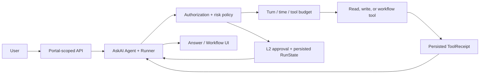

# P0 Agentic Closed Loop

Date: 2026-07-24

## Outcome

AskAI remains the only SDK Agent. Dralk and Meeting remain workflows, but the
Agent now starts them through registered function tools and consumes their tool
receipts in the same run. UI actions are derived from verified tool execution;
model-generated actions remain only as a compatibility fallback.

## Runtime path



## P0 changes

- Real workflow tools: `start_dralk_workflow`, `start_meeting_workflow`.
- Central tool policy: permission snapshot, risk level, project/conversation
  ownership, and tenant checks.
- L2 approval: both ToDo and Calendar writes interrupt before execution.
- Runtime bounds: max turns, overall timeout, per-tool timeout, total tool calls,
  per-tool calls, and tool concurrency.
- Idempotency: artifact, ToDo, and Calendar writes use deterministic keys.
- Principal isolation: conversations, user Collections, artifacts, workflow
  mutations, audit events, and tool metrics are user/tenant scoped.
- Production safety: mock reset endpoint is unavailable outside development or
  explicit eval mode.

## Verification

Run:

```bash
npm run typecheck
npm run eval:p0:live
npm run build
```

`eval:p0:live` starts an isolated Next.js server with a temporary SQLite
database and runs the real model/Agent loop. It asserts:

1. Dralk is started by a completed tool call and returns a persisted
   `workflowRequest`.
2. Meeting is started by a completed tool call and returns a UI opening signal.
3. `create_todo` interrupts before execution.
4. Approval resumes the persisted SDK `RunState`.
5. The write occurs exactly once.
6. Tool-call budgets are respected.
7. Cross-user/cross-tenant task reads are rejected.

## Remaining boundary

This is a credible request-driven Agent loop, not an autonomous background
agent. It has no event scheduler, long-running planner, or unattended execution.
Meeting, Calendar, and ToDo still use deterministic mock adapters by product
decision; the orchestration, approval, persistence, and recovery path are real.
